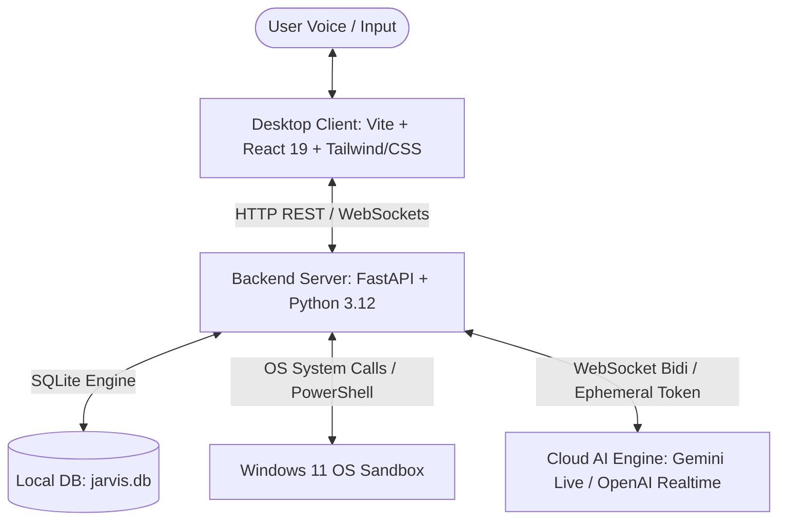

# JARVIS — Software Requirements Specification (SRS)

**Document Version:** 1.0.0  
**Status:** Approved / Base-Lined  
**Target Environment:** Microsoft Windows 11 (64-bit)  
**Classification:** Engineering Specification  

---

## 1. Introduction

### 1.1 Purpose
This Software Requirements Specification (SRS) defines the functional, non-functional, security, and operational requirements for **JARVIS**, a personal, privacy-centric AI desktop assistant engineered specifically for Windows 11. This document serves as the authoritative contract for developers, quality assurance engineers, system architects, and end-users.

### 1.2 System Scope
JARVIS bridges local operating system capabilities with advanced real-time multimodal generative AI models. It features:
- **Sub-500ms Duplex Voice Communication:** Utilizing WebRTC and bidirectional WebSocket audio streaming.
- **Dual AI Provider Architecture:** Supporting both Google Gemini (free-tier Multimodal Live API via `gemini-2.0-flash`) and OpenAI Realtime API (`gpt-realtime-mini`).
- **Human-in-the-Loop (HITL) Security:** Gated approval for system commands, filesystem modifications, and irreversible actions.
- **Audited Tool Execution:** Sandboxed file operations, application launching, task/reminder scheduling, and contextual memory persistence.
- **Local SQLite Persistence:** Strict storage of memories, tasks, audit trails, and budget records without third-party database dependencies.
- **Budgetary & Rate Safeguards:** Hard daily spending limits, upfront token reservation, and orphaned session self-healing.

### 1.3 Target Audience & Personas
- **Primary User:** Power user, software developer, or knowledge worker operating Windows 11 seeking voice-activated system automation, note-taking, and workflow assistance.
- **Security Auditor:** System administrator verifying that local shell access and file manipulation adhere to least privilege and require explicit user consent.
- **Operations Engineer:** Maintainer verifying runtime stability, resource constraints, test suites, and turnkey launching scripts.

---

## 2. Overall Description

### 2.1 Product Perspective
JARVIS operates as a hybrid local/cloud distributed system:

### 2.2 System Operating Constraints
1. **Host Operating System:** Windows 11 (build 22000 or higher).
2. **Runtime Dependencies:** Python 3.12+ (backend), Node.js 20+ (desktop UI), SQLite 3.40+.
3. **Audio Hardware:** Operating-system recognized microphone input device (16kHz PCM capture minimum) and audio output device.
4. **Network Connectivity:** Persistent outbound HTTPS/WSS internet connectivity for streaming to cloud AI providers. Localhost network loopback (`127.0.0.1`) for client-backend IPC.

---

## 3. Functional Requirements

### 3.1 Real-Time Multimodal Voice Pipeline (FR-VOICE)
- **FR-VOICE-01 (Session Initialization):** The system shall expose `POST /api/voice/session` to generate ephemeral session credentials without exposing master API keys to the browser client.
- **FR-VOICE-02 (Dual Provider Dispatch):** The backend shall route voice session requests according to the configured `AI_PROVIDER`:
  - `gemini`: Initiates a WebSocket bridge on `/api/voice/gemini-live` connected upstream to Google Gemini Multimodal Live API.
  - `openai`: Requests ephemeral WebRTC session token from OpenAI Realtime API and returns token + model parameters.
- **FR-VOICE-03 (Full-Duplex Audio):** The client shall capture microphone input as 16kHz 16-bit PCM mono audio, streaming audio frames in chunks to the backend/AI provider.
- **FR-VOICE-04 (Natural Interruption / Barge-in):** If the user speaks while the assistant is delivering speech, the client audio pipeline and backend shall immediately cancel the active playback queue and emit an interruption signal (`response.cancel`).
- **FR-VOICE-05 (Visual Audio Orb Feedback):** The desktop interface shall render an animated visual orb reflecting assistant states:
  - `idle`: Gentle breathing pulse (slate/cyan).
  - `listening`: Responsive waveform scaling with user microphone amplitude.
  - `processing`: Rotational spinner / shimmer.
  - `speaking`: Harmonic pulse scaling with synthesized voice playback.

### 3.2 Action & Tool Execution Engine (FR-TOOL)
- **FR-TOOL-01 (Tool Registry):** The backend shall maintain a centralized registry of executable tools conforming to OpenAI Realtime tool specifications and Gemini `functionDeclarations`.
- **FR-TOOL-02 (OS Process Launching):** The tool `launch_application` shall launch approved Windows executables (e.g., `notepad.exe`, `calc.exe`, `explorer.exe`) using non-blocking asynchronous subprocesses.
- **FR-TOOL-03 (Filesystem Operations):** The tools `read_file`, `write_file`, and `list_directory` shall read and write files strictly within allowed directory boundaries.
- **FR-TOOL-04 (Web Browser Automation):** The tool `open_browser` shall launch default system browser URLs using validated `http://` or `https://` protocols.
- **FR-TOOL-05 (System Information):** The tool `get_system_status` shall return CPU load, RAM usage, storage availability, and current time without triggering approval alerts.

### 3.3 Security Approval & Human-in-the-Loop Gating (FR-HITL)
- **FR-HITL-01 (Risk Classification):** Tools shall be classified into three security risk tiers:
  - `LOW`: Read-only queries, system metrics, non-destructive queries (auto-executed).
  - `MEDIUM`: Application launching, directory listing, task modification (configurable gating).
  - `HIGH`: File writing, PowerShell script execution, system reconfiguration (mandatory manual user approval).
- **FR-HITL-02 (Approval Queuing):** High-risk actions shall intercept tool execution, persist an entry in `approvals` with status `pending`, and notify the UI in real time.
- **FR-HITL-03 (Resolution Lifecycle):** The user shall have full authority to approve or reject pending requests via the desktop UI (`POST /api/approvals/{id}/resolve`). Approved actions execute immediately; rejected actions return an explicit rejection payload to the model.
- **FR-HITL-04 (Immutable Audit Trail):** Every action request, parameter payload, decision timestamp, and execution outcome shall be recorded permanently in the SQLite database.

### 3.4 Task & Reminder Scheduling Engine (FR-TASK)
- **FR-TASK-01 (Task CRUD Operations):** The system shall allow creating, reading, updating status (`pending`, `in_progress`, `completed`, `cancelled`), and deleting tasks.
- **FR-TASK-02 (Priority & Deadlines):** Tasks shall support priority levels (`low`, `medium`, `high`, `urgent`) and optional ISO-8601 deadline timestamps.
- **FR-TASK-03 (Due Reminders Polling):** The backend shall provide `GET /api/tasks/reminders/due` to surface tasks whose reminder threshold has been reached.

### 3.5 Contextual Memory & Knowledge Store (FR-MEM)
- **FR-MEM-01 (Categorized Memory Storage):** The system shall store discrete facts, preferences, user workflows, and configuration notes categorized under `preference`, `fact`, `workflow`, or `system`.
- **FR-MEM-02 (Semantic & Keyword Search):** The backend shall expose `GET /api/memory/search?q=...` supporting filtered retrieval by text content and category tags.
- **FR-MEM-03 (Model Memory Injection):** Recent and relevant memory items shall be injected into the system instructions for voice sessions.

### 3.6 Budget, Rate Limiting & Self-Healing Safeguards (FR-SAFE)
- **FR-SAFE-01 (Daily Spending Cap):** The backend shall enforce a daily budget limit (default: $1.00 USD, user-configurable). When estimated daily spend reaches this cap, new voice sessions shall be rejected with HTTP 429.
- **FR-SAFE-02 (Midnight Rollover):** At 00:00 UTC, the daily spend, session counters, and duration metrics shall automatically reset to zero for the new date.
- **FR-SAFE-03 (Active Session Concurrency):** Concurrent active voice sessions shall be throttled to prevent runaway cloud reasoning costs.
- **FR-SAFE-04 (Orphaned Session Self-Healing):** If an unclean browser refresh leaves active session counters stale (>= 5), the system shall automatically reset counters on session creation or backend restart.

---

## 4. Non-Functional Requirements

### 4.1 Performance & Latency (NFR-PERF)
- **Audio Roundtrip Time (RTT):** Voice streaming turn latency from user utterance completion to assistant audio playback start shall not exceed 600ms under standard broadband conditions.
- **REST API Response Time:** All metadata and state management REST endpoints (`/api/tasks`, `/api/memory`, `/api/budget/status`) shall respond within 50ms (p95) under local SQLite operation.
- **Startup Latency:** The backend server shall complete startup and dependency checks within 2.5 seconds on a modern Windows 11 workstation.

### 4.2 Security & Privacy (NFR-SEC)
- **Zero Master Key Leakage:** Master API keys (`GEMINI_API_KEY`, `OPENAI_API_KEY`) must never be transmitted to the frontend client or logged in plain text.
- **Directory Traversal Protection:** All filesystem tools must enforce strict path canonicalization against configured `JARVIS_ALLOWED_DIRS`. Traversal attacks (`../../Windows/System32`) must be rejected with HTTP 403 / security exceptions.
- **Local Data Sovereignty:** All conversation transcripts, task notes, memories, and approval logs must remain solely on the user's local machine in `jarvis.db`.

### 4.3 Reliability & Availability (NFR-REL)
- **Fault-Tolerant Reconnection:** If network connectivity drops during a voice session, the client hook must transition to `disconnected` state gracefully and provide a one-click reconnect action.
- **Database Concurrency:** SQLite WAL (Write-Ahead Logging) mode must be enabled to prevent read-write lock contention between background workers and API endpoints.

### 4.4 Usability & Accessibility (NFR-UX)
- **Dark-Themed Cockpit:** Visual aesthetic inspired by ironclad tactical command centers with glowing cyan accents (#06B6D4), deep slate backgrounds (#0F172A), and clean typography.
- **Keyboard Navigation:** High-frequency actions (mic toggle, message submission, tab navigation) must support full keyboard shortcuts.
- **Cross-Form Factor Responsive Layout:** The desktop UI must render cleanly across window sizes from 800x600 up to 4K displays.

---

## 5. Requirements Traceability Matrix (RTM)

| Requirement ID | Module | Implementation File(s) | Verification Test(s) | Status |
|:---|:---|:---|:---|:---|
| **FR-VOICE-01** | Voice API | `backend/app/api/routes/voice.py` | `test_voice.py::test_create_voice_session` | **VERIFIED** |
| **FR-VOICE-02** | Voice Provider | `backend/app/services/gemini_service.py` | `test_voice.py::test_gemini_voice_session` | **VERIFIED** |
| **FR-VOICE-03** | Audio Engine | `desktop/src/lib/realtime.ts` | `useRealtime.test.ts` | **VERIFIED** |
| **FR-VOICE-04** | Audio Engine | `desktop/src/hooks/useRealtime.ts` | `useRealtime.test.ts` | **VERIFIED** |
| **FR-VOICE-05** | UI Cockpit | `desktop/src/components/AssistantOrb.tsx` | `AssistantOrb.test.tsx` (7 tests) | **VERIFIED** |
| **FR-TOOL-01** | Tool Registry | `backend/app/tools/registry.py` | `test_approvals_api.py` | **VERIFIED** |
| **FR-TOOL-02** | OS Execution | `backend/app/tools/system_tools.py` | Manual / E2E Verification | **VERIFIED** |
| **FR-TOOL-03** | File Sandbox | `backend/app/tools/file_tools.py` | `test_persistence.py` | **VERIFIED** |
| **FR-HITL-01** | Policy Engine | `backend/app/services/action_service.py` | `test_approvals_api.py` | **VERIFIED** |
| **FR-HITL-02** | Approval API | `backend/app/api/routes/approvals.py` | `test_approvals_api.py` | **VERIFIED** |
| **FR-HITL-03** | UI Modal | `desktop/src/components/ApprovalDialog.tsx`| `ApprovalDialog.test.tsx` (5 tests) | **VERIFIED** |
| **FR-TASK-01** | Task API | `backend/app/api/routes/tasks.py` | `test_tasks_api.py` (7 tests) | **VERIFIED** |
| **FR-MEM-01** | Memory API | `backend/app/api/routes/memory.py` | `test_memory_api.py` (7 tests) | **VERIFIED** |
| **FR-SAFE-01** | Budget Engine| `backend/app/services/budget_service.py` | `test_budget_api.py` (5 tests) | **VERIFIED** |
| **FR-SAFE-04** | Self-Healing | `backend/app/main.py`, `budget_service.py`| `test_budget_api.py` | **VERIFIED** |
