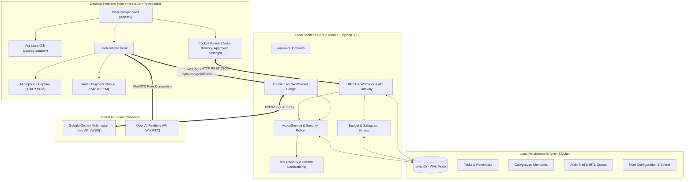
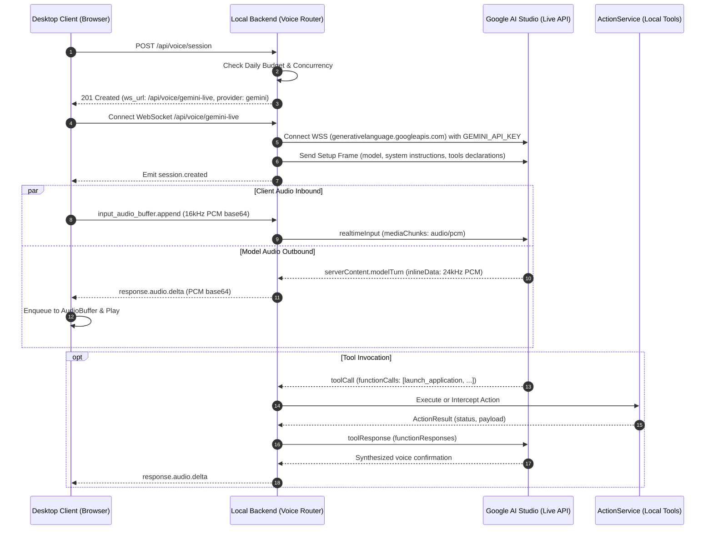
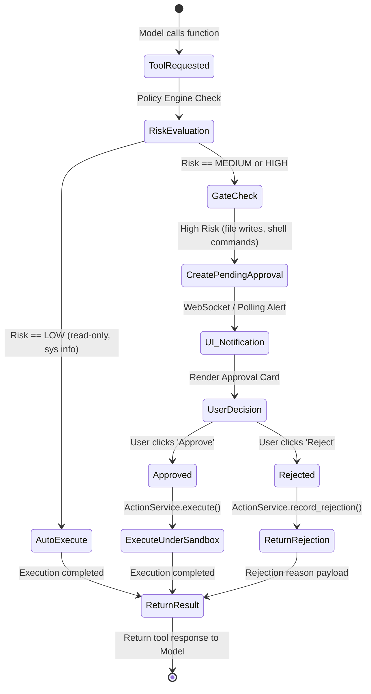
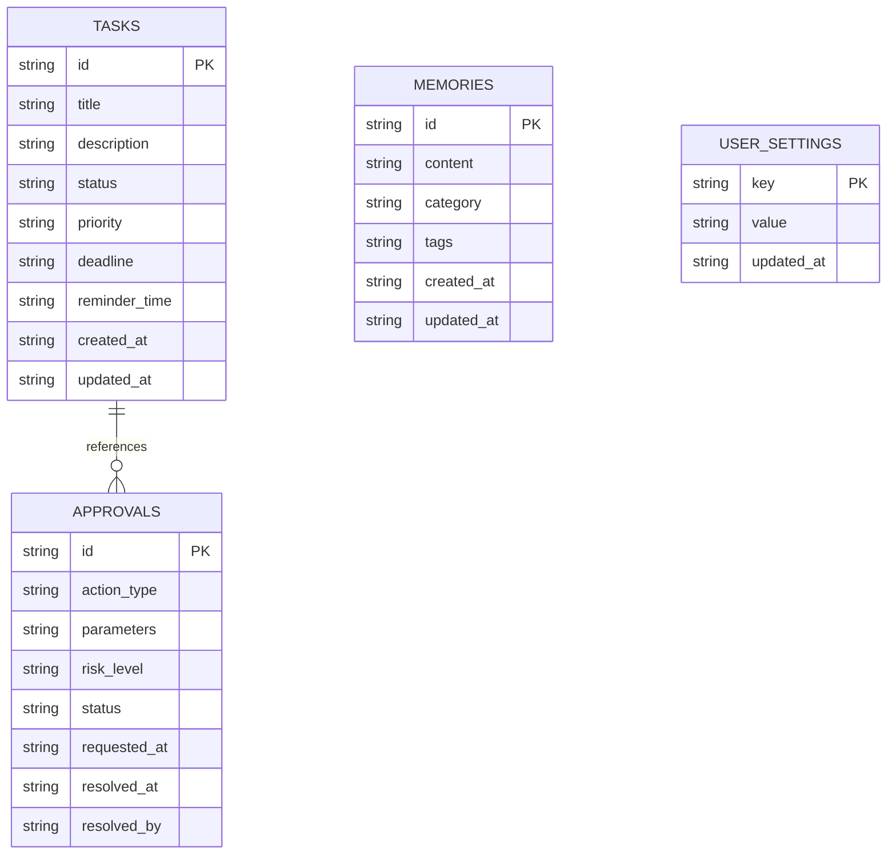

# JARVIS — System Architecture Document & High-Level Design (HLD)

**Document Version:** 1.0.0  
**Status:** Approved / Base-Lined  
**Classification:** Technical Architecture Specification  

---

## 1. Architectural Vision & Topology

JARVIS is designed as a hybrid edge/cloud desktop architecture. The system executes low-latency local operations (process management, file I/O, task storage, approval gating) on the local workstation while leveraging hyperscale multimodal models (Google Gemini and OpenAI) for conversational reasoning and real-time audio synthesis.

### 1.1 High-Level Component Topology



---

## 2. Dual-Provider AI Strategy

JARVIS implements an abstraction layer allowing users to switch dynamically between AI reasoning engines based on cost, availability, or preference.

### 2.1 Provider Architecture Comparison

| Dimension | Google Gemini Multimodal Live | OpenAI Realtime API |
|:---|:---|:---|
| **Underlying Model** | `gemini-2.0-flash` (or `gemini-2.5-flash`) | `gpt-realtime-mini` / `gpt-4o-realtime` |
| **Connection Protocol** | Bidirectional WebSocket (`wss://`) | WebRTC (`RTCPeerConnection` + DataChannel) |
| **Cost Profile** | **Free Tier** via Google AI Studio | Metered token pricing per minute/audio byte |
| **Credential Topology**| Server-mediated bridge (Client -> FastAPI -> Google) | Ephemeral client secret generated by backend |
| **Client Exposure** | Zero client key exposure | Ephemeral short-lived secret (expires in 60s) |
| **Audio Format In** | 16kHz 16-bit mono Little-Endian PCM | 24kHz or 16kHz G.711 / PCM |
| **Audio Format Out** | 24kHz 16-bit mono Little-Endian PCM | 24kHz 16-bit mono PCM |
| **Tool Calling** | Bidi `toolCall` / `toolResponse` frames | DataChannel `response.function_call_arguments.done` |

### 2.2 Google Gemini WebSocket Bridge Architecture

Because browser clients cannot safely store long-term Google AI Studio keys or maintain authenticated raw WebSockets to Google APIs without exposing credentials, the FastAPI backend acts as an authenticated stateful gateway:



---

## 3. Audio Processing & Real-Time Signal Flow

The audio subsystem operates on a dual-channel architecture separating microphone ingestion from model audio synthesis.

```mermaid
graph LR
    subgraph CapturePipeline["Microphone Capture Pipeline"]
        Mic[Microphone Input] --> AudioCtxIn[AudioContext @ 16kHz]
        AudioCtxIn --> AnalyserIn[AnalyserNode (FFT: 256)]
        AnalyserIn --> Processor[ScriptProcessor / Worklet]
        Processor --> Int16Conv[Float32 to Int16 PCM]
        Int16Conv --> Base64Enc[Base64 Encoding]
        Base64Enc --> WSOut[WebSocket / DataChannel Frame]
    end

    subgraph PlaybackPipeline["Assistant Playback Pipeline"]
        WSIn[Inbound Audio Delta] --> Base64Dec[Base64 Decode]
        Base64Dec --> Int16ToFloat[Int16 to Float32]
        Int16ToFloat --> AudioQueue[Sequential AudioBuffer Queue]
        AudioQueue --> AudioCtxOut[AudioContext @ 24kHz]
        AudioCtxOut --> AnalyserOut[AnalyserNode (FFT: 256)]
        AnalyserOut --> Speakers[Speaker / Headphone Output]
    end
```

### 3.1 Natural Interruption (Barge-in) Handling
When the user speaks while the assistant is talking:
1. The client-side voice activity detector (or server VAD) registers voice input amplitude exceeding the noise floor.
2. The client immediately stops the active `AudioBufferSourceNode` playback queue.
3. The client sends a `response.cancel` event to the backend/AI provider.
4. The assistant halts token generation and audio streaming instantly, ready for the user's new prompt.

---

## 4. Security & Human-in-the-Loop (HITL) Architecture



---

## 5. Storage & Persistence Architecture

The system uses an embedded SQLite database engine configured with:
- **Write-Ahead Logging (`PRAGMA journal_mode=WAL;`):** Enables non-blocking concurrent readers while background writes occur.
- **Foreign Keys (`PRAGMA foreign_keys=ON;`):** Enforces relational integrity across entities.
- **Normal Form Schema:** Eliminates data duplication and guarantees relational consistency.

### 5.1 Relational Architecture Diagram



---

## 6. System Resiliency & Self-Healing Architecture

1. **Stale Session Self-Healing:** The backend monitors concurrent active sessions (`budget_active_sessions`). If browser tabs are closed abruptly without an explicit disconnect handshake, sessions could remain artificially elevated. The system self-heals by:
   - Resetting active sessions to zero upon backend server boot via FastAPI lifespan hooks.
   - Auto-reclaiming active session slots when creating a new session if counters exceed threshold bounds.
2. **Budget Rollover Automation:** Every budget query automatically checks if `budget_date < current_utc_date`. If a new day has arrived, spend and session metrics reset to zero atomically without requiring scheduled cron tasks.
3. **Database Connection Fault Tolerance:** The SQLAlchemy session factory implements short-lived scoped sessions with deterministic try/finally closures to prevent connection exhaustion.
