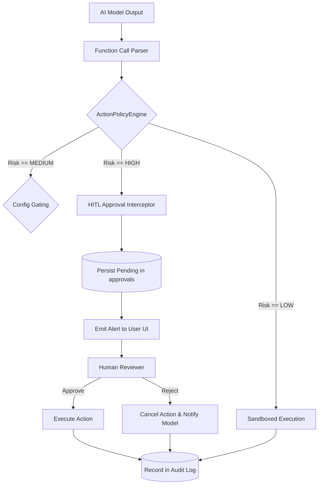
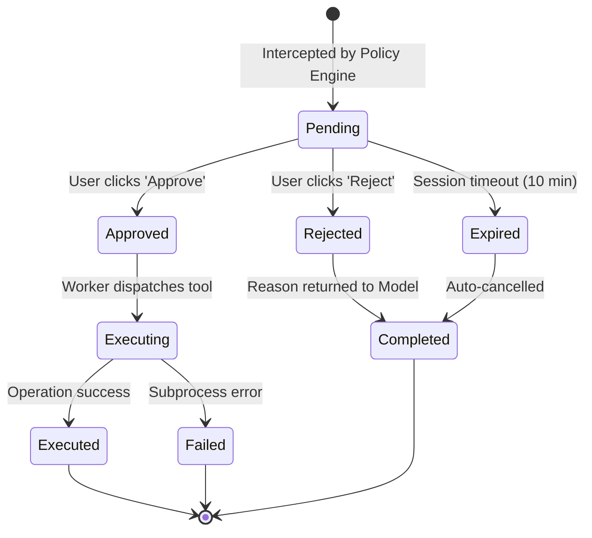

# JARVIS — Security, Governance & Threat Model Specification

**Document Version:** 1.0.0  
**Status:** Approved / Base-Lined  
**Classification:** Security Architecture & Compliance  

---

## 1. Security Architecture Principles

JARVIS adheres to Defense-in-Depth and Least Privilege principles. Because generative AI models can be susceptible to prompt injection, social engineering, or hallucinated commands, JARVIS enforces strict deterministic code boundaries around all OS interactions. The AI model has **no direct shell or filesystem privileges**; all operations pass through an intermediate policy verification engine.



---

## 2. STRIDE Threat Model & Mitigations

| Threat Category | Specific System Risk | Mitigation Strategy | Implementation Point |
|:---|:---|:---|:---|
| **Spoofing (Identity)** | Unauthorized remote client connecting to local backend API | Backend binds exclusively to `127.0.0.1` (localhost). External network traffic is blocked by Windows Firewall. | `backend/app/main.py` (`HOST=127.0.0.1`) |
| **Tampering (Data)** | Prompt injection modifying system files, registry, or startup scripts | Sandboxed directories enforcement. Path resolution prevents escaping designated root. | `backend/app/tools/file_tools.py` |
| **Repudiation** | User or system disputes whether an action was authorized | Immutable database audit trail recording timestamp, exact JSON payload, decision (`approved`/`rejected`), and decider. | `backend/app/models/approval.py` |
| **Information Disclosure** | Master Google Gemini or OpenAI API keys exposed to browser | Zero Master Key Exposure: Backend mediates all streaming or returns ephemeral single-use WebRTC secrets. | `backend/app/services/gemini_service.py` |
| **Denial of Service** | Malicious loops draining API credits through infinite voice streaming | Hard daily spend caps ($1.00 default) + concurrent session limits + automatic timeout and self-healing. | `backend/app/services/budget_service.py` |
| **Elevation of Privilege** | Model hallucinates or is coerced into running arbitrary PowerShell | High-risk action gating: Shell commands require explicit manual human confirmation in UI modal. | `backend/app/services/action_service.py` |

---

## 3. Human-in-the-Loop (HITL) Approval Gating

### 3.1 Risk Classification Tiers

1. **Tier 1: LOW Risk (Autonomous Execution)**
   - Read-only operations that do not modify machine state or leak sensitive files.
   - Examples: `get_system_status`, `list_directory`, `read_file` (within allowed directory), `open_browser` (validated HTTP/HTTPS).
   - Execution: Autonomous; logged in audit trail.

2. **Tier 2: MEDIUM Risk (Operational Safeguards)**
   - Actions that modify assistant state or launch non-destructive desktop applications.
   - Examples: `launch_application` (`calc.exe`, `notepad.exe`), `manage_task`, `manage_memory`.
   - Execution: Executed autonomously if whitelisted; can be configured to require confirmation in `Settings`.

3. **Tier 3: HIGH Risk (Mandatory Human Approval)**
   - Actions that write to the filesystem, delete resources, execute PowerShell scripts, or alter system settings.
   - Examples: `write_file`, `execute_powershell`, `delete_task`, `execute_system_command`.
   - Execution: **Always intercepted**. The backend halts execution, enqueues a record in the `approvals` table with status `pending`, and presents an interactive approval card in the UI.

### 3.2 Approval State Machine



---

## 4. Filesystem Sandboxing & Traversal Prevention

The file operations tools (`read_file`, `write_file`, `list_directory`) implement canonical path validation to prevent Directory Traversal attacks (e.g., `..\..\Windows\System32\cmd.exe`):

```python
def is_safe_path(target_path: Path, allowed_roots: list[Path]) -> bool:
    """Validate that target_path resolves strictly within one of the allowed_roots."""
    # 1. Resolve symlinks and canonical absolute path
    resolved_target = target_path.resolve()
    
    # 2. Check against each canonical allowed directory
    for root in allowed_roots:
        resolved_root = root.resolve()
        if resolved_target == resolved_root or resolved_root in resolved_target.parents:
            return True
            
    return False
```

### 4.1 Sandboxing Rules:
1. If `JARVIS_ALLOWED_DIRS` is empty, file operations are restricted to `backend/data/` or the project root.
2. Direct access to system directories (`C:\Windows`, `C:\Program Files`, root user directories) is strictly forbidden.
3. Path inputs containing null bytes (`\0`) or invalid URI encodings are rejected immediately.

---

## 5. Ephemeral Credential Lifecycle & Privacy

1. **Zero Client Secret Exposure:**
   - For Google Gemini: The browser **never** receives `GEMINI_API_KEY`. The browser connects to `ws://127.0.0.1:8000/api/voice/gemini-live`. The FastAPI server connects to Google over TLS (`wss://generativelanguage.googleapis.com`) using the server's private environment key.
   - For OpenAI: The backend requests an ephemeral, single-use client secret (`ek_...`) from `https://api.openai.com/v1/realtime/sessions` that expires within 60 seconds.
2. **Environment Variable Hygiene:**
   - `.env` files are explicitly excluded via `.gitignore`.
   - Test suites enforce `env_file=None` and automated fixture clearing (`clean_test_env`) so that production developer keys are never exposed or tested against accidentally.
3. **Local Data Sovereignty:**
   - Conversation logs, tasks, memories, and approval logs are stored purely in the local SQLite database (`jarvis.db`). No telemetry or telemetry logs are transmitted to external servers.
