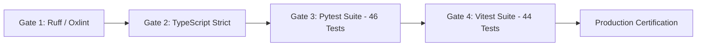

# JARVIS — Test Plan & Quality Assurance (QA) Specification

**Document Version:** 1.0.0  
**Status:** Approved / Base-Lined  
**Classification:** Quality Assurance & Testing Engineering  

---

## 1. Quality Assurance Strategy & Philosophy

JARVIS utilizes a multi-tiered automated verification matrix. Due to the high stakes of desktop system integration and real-time audio streaming, our testing methodology adheres to strict determinism:
- **Zero Flakiness:** Tests do not rely on live internet connections or paid cloud API endpoints; all external network protocols (WebRTC, WebSocket streaming, OpenAI/Google APIs) are tested via contract mocks and isolation fixtures.
- **Environment Isolation:** Test execution automatically disables developer environment files (`.env`), ensuring that locally configured personal API keys cannot leak into or alter test assertions.
- **Dual-Stack Automation:** Continuous validation across both Python backend (Pytest + AnyIO) and React/TypeScript desktop frontend (Vitest + React Testing Library).

---

## 2. Quality Gates & Acceptance Standards

A build is certified for production deployment only when it satisfies all four quality gates:



1. **Gate 1 (Linter & Formatting):** Ruff (`ruff check app tests`) and Oxlint must complete with 0 errors and 0 warnings.
2. **Gate 2 (Type Soundness):** Strict TypeScript compilation (`tsc --noEmit`) must succeed with 0 errors.
3. **Gate 3 (Backend Verification):** 100% of backend tests (46/46) must pass under Pytest.
4. **Gate 4 (Frontend Verification):** 100% of frontend tests (44/44 across 9 suites) must pass under Vitest.

---

## 3. Backend Test Suite Breakdown (46 Tests)

| Test Suite File | Test Count | Scope & Behaviors Verified |
|:---|:---:|:---|
| `test_approvals_api.py` | 7 | Approval listing, pending queue filtering, resolve endpoint (approve/reject), risk-based gating, audit trail immutability. |
| `test_budget_api.py` | 5 | Daily spending limit retrieval, custom limit modification, usage recording, midnight rollover calculations, safeguard blocking. |
| `test_config.py` | 5 | Settings initialization, environment variable defaults, API key validation, directory whitelisting, test environment isolation. |
| `test_errors.py` | 2 | Custom `AppError` and `ConfigurationError` serialization, RFC-7807 compliant error responses, HTTP status mapping. |
| `test_health.py` | 1 | Health check endpoint (`GET /api/health`), service metadata, version matching. |
| `test_logging.py` | 1 | Structured logging format, request correlation ID propagation, log level overrides. |
| `test_memory_api.py` | 7 | Memory CRUD, category filtering (`preference`, `fact`, `workflow`, `system`), substring search, deduplication. |
| `test_models.py` | 5 | SQLAlchemy ORM models, primary key UUID generation, default timestamps, relational constraints. |
| `test_persistence.py` | 1 | SQLite database initialization, table creation, WAL mode configuration, scoped session cleanup. |
| `test_tasks_api.py` | 7 | Task CRUD operations, status transitions, priority filtering, due reminders query, deadline parsing. |
| `test_voice.py` | 5 | Voice session creation for OpenAI (ephemeral token) and Gemini (WebSocket URL), error handling for missing keys, budget rejection. |

**Total Backend Test Count:** **46 Passed**

---

## 4. Frontend Test Suite Breakdown (44 Tests across 9 Suites)

| Test Suite File | Test Count | Scope & Behaviors Verified |
|:---|:---:|:---|
| `src/hooks/useRealtime.test.ts` | 4 | Hook lifecycle, audio initialization, connection state transitions (`disconnected` -> `connecting` -> `connected`), session duration reporting. |
| `src/components/AssistantOrb.test.tsx` | 7 | Orb animation states (`idle`, `listening`, `processing`, `speaking`), dynamic audio level scaling, SVG visualizer fidelity. |
| `src/components/VoiceControls.test.tsx` | 3 | Mic toggle button, connection status indicators, mute/unmute states, keyboard accessibility. |
| `src/components/ConversationPanel.test.tsx`| 3 | Message history rendering, typed prompt submission (Enter key and submit button), role-based message styling. |
| `src/components/ApprovalDialog.test.tsx` | 5 | Pending approval cards, parameter inspector, approve/reject action dispatch, empty state rendering. |
| `src/components/SettingsPanel.test.tsx` | 3 | Daily budget metrics display, custom limit form submission, AI provider and voice configuration toggles. |
| `src/components/TaskPanel.test.tsx` | 5 | Task listing, priority chips, new task creation form, status checkbox toggling, deadline formatting. |
| `src/components/MemoryPanel.test.tsx` | 7 | Memory listing, category filtering, search input filtering, new memory entry modal, deletion handling. |
| `src/App.test.tsx` | 7 | Cockpit shell rendering, navigation tab switching (Tasks, Memory, Approvals, Settings), backend online/offline status handling. |

**Total Frontend Test Count:** **44 Passed**

---

## 5. Test Isolation & Mocking Strategy

### 5.1 Backend Isolation Architecture
- **In-Memory SQLite:** Testing uses in-memory or dedicated temporary SQLite instances (`sqlite:///:memory:`) to ensure zero test state pollution.
- **Autouse Test Fixture (`clean_test_env`):**
  ```python
  @pytest.fixture(autouse=True)
  def clean_test_env(monkeypatch):
      """Ensure developer keys in .env never affect unit test assertions."""
      monkeypatch.setenv("APP_ENV", "test")
      monkeypatch.delenv("GEMINI_API_KEY", raising=False)
      monkeypatch.delenv("OPENAI_API_KEY", raising=False)
  ```

### 5.2 Frontend Mocking Architecture
- **Web Audio API Mock:** Because `jsdom` lacks native Web Audio DSP nodes (`AudioContext`, `AnalyserNode`), `setupTests.ts` provides complete mock implementations simulating frequency data arrays and volume normalization.
- **REST API Mocking:** Vitest mocks `./lib/api` to return deterministic payloads, testing optimistic UI updates and unmount cleanups (`recordSessionUsage`).

---

## 6. Verification Execution Commands

To execute the complete quality assurance suite locally on Windows 11:

```powershell
# 1. Run Complete Turnkey System Verification
.\verify_system.bat

# 2. Or run individual test phases:
# Backend Tests:
cd backend
.venv\Scripts\python.exe -m pytest

# Frontend Typecheck & Tests:
cd ..\desktop
npm run typecheck
npm test
```
